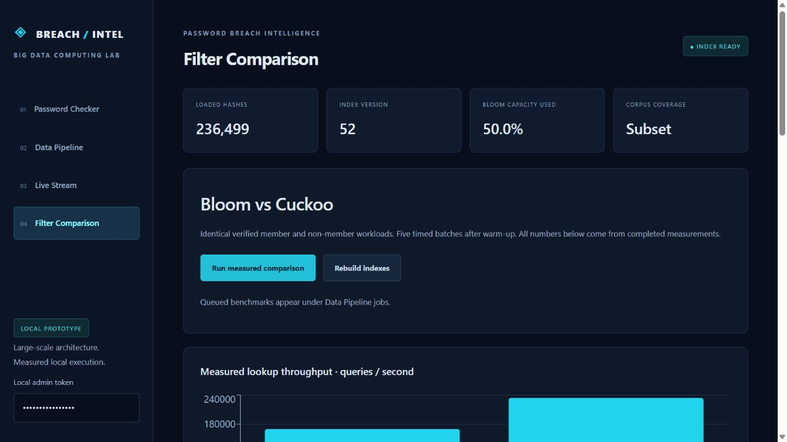
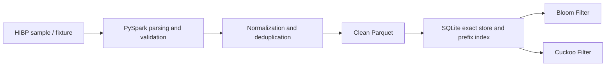
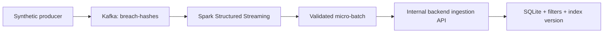

# Password Breach Intelligence Dashboard

### Large-Scale Password Breach Intelligence and Privacy-Preserving Detection

A Big Data Computing mini-project that cleans real compromised-password **SHA-1 hashes** with PySpark, builds **Bloom and Cuckoo Filters**, and checks passwords through **browser-local hashing and prefix-only queries**. Kafka and Spark Structured Streaming demonstrate incremental updates with clearly labelled synthetic events.

**Local prototype:** real data, real Spark processing, real Kafka transport, and measured results. The loaded corpus is a subset; this is not a live feed of newly discovered breaches or a claim of billion-record processing.



**[Team handoff PDF](output/pdf/Password_Breach_Intelligence_Team_Handoff.pdf)** · **[Demo guide](docs/DEMO_GUIDE.md)** · **[Verification report](docs/VERIFICATION.md)**

## Features

- **Bounded real-data acquisition:** selected HIBP ranges, reconstructed full hashes, provenance and file checksum.
- **Spark preprocessing:** TXT/CSV/JSON/JSONL and optional GZIP; normalization, validation, deduplication and clean Parquet.
- **Reproducible cleaning fixture:** duplicates, whitespace/case variants and invalid rows checked against an expected-results manifest.
- **Exact storage:** SQLite with full hashes, occurrence counts, source labels and an indexed five-character prefix.
- **Bloom Filter:** packed bits, deterministic positions, sizing equations, membership operations and serialization.
- **Cuckoo Filter:** short fingerprints, two candidate buckets, bounded relocation, safe failure rollback and controlled deletion.
- **Private checker:** browser-local SHA-1, prefix-only transmission and local exact suffix comparison.
- **Streaming updates:** real Kafka KRaft transport and Spark Structured Streaming with checkpoints and replay-safe ingestion.
- **Measured dashboard:** actual processing reports, applied batches, index versions, benchmark charts and errors.
- **Reliability:** exact-store deduplication, startup index reconstruction, capacity rebuilding and isolated demo snapshots.

## Technology stack

| Layer | Technology |
|---|---|
| Frontend | React, TypeScript, Vite, Tailwind CSS, Recharts |
| Backend | Python, FastAPI, Pydantic; one API worker |
| Batch processing | PySpark 3.5.7 DataFrames |
| Streaming | Spark Structured Streaming + Kafka 3.7.1 in KRaft mode |
| Storage | SQLite and Parquet |
| Membership structures | Custom packed Bloom and bucket-based Cuckoo Filters |
| Browser hashing | Web Crypto SHA-1 |
| Tests | pytest, Vitest, TypeScript/Vite build |
| Infrastructure | Docker Compose; independently verified Ubuntu WSL2 fallback |

Exact versions are pinned in [frontend/package.json](frontend/package.json), its lockfile, and [backend/requirements.txt](backend/requirements.txt). Use Java **17** with the selected Spark setup and the matching connector: `org.apache.spark:spark-sql-kafka-0-10_2.12:3.5.7`.

## Project structure

```text
BDC---Mini-Project/
├── backend/
│   ├── app/
│   │   ├── main.py                 # APIs, jobs and simulation controls
│   │   ├── store.py                # SQLite, prefix queries, live indexes
│   │   ├── filters.py              # Bloom and Cuckoo implementations
│   │   └── benchmark.py            # Measured comparison
│   ├── tests/                     # Unit, Spark, API and integration tests
│   └── requirements.txt
├── frontend/
│   ├── src/
│   │   ├── main.tsx               # Four-section dashboard
│   │   ├── privacy.ts             # Browser hashing and local matching
│   │   └── privacy.test.ts
│   ├── package.json
│   └── package-lock.json
├── spark/
│   ├── batch_pipeline.py          # Cleaning and Parquet output
│   └── streaming_pipeline.py      # Kafka consumption and micro-batches
├── scripts/                       # Acquisition, fixtures, demos and setup
├── data/
│   ├── fixtures/                  # Small synthetic fixture + manifest
│   ├── raw/                       # Downloaded data; excluded from Git
│   └── processed/                 # Generated Parquet; excluded from Git
├── artifacts/metrics/             # Generated run evidence
├── docs/                          # Setup, architecture, demo and reports
├── output/pdf/                    # Shareable team handoff PDF
├── Dockerfile
├── docker-compose.yml
├── .env.example
└── README.md
```

Large datasets, databases, checkpoints, runtimes, virtual environments and secrets are excluded from Git. Small synthetic fixtures, saved measurement summaries and the teammate PDF are included.

## How it works

### Historical processing



Hash strings are trimmed at the edges and uppercased, then validated as exactly 40 hexadecimal characters. Counts must be non-negative integers. Duplicate hashes retain the **maximum observed count**, rather than summing duplicated copies, while preserving source labels.

### Private password lookup

1. Enter a password and click **Check exposure**.
2. The browser calculates SHA-1 without changing password case or whitespace.
3. Only its five-character prefix is sent to `GET /api/range/{prefix}`.
4. SQLite returns candidate suffixes and occurrence counts.
5. The browser compares its suffix locally and displays **found/not found in the loaded dataset**.

For the public demonstration string `password`:

```text
SHA-1:  5BAA61E4C9B93F3F0682250B6CF8331B7EE68FD8
Prefix: 5BAA6
Request: GET /api/range/5BAA6
```

**Prefix retrieval uses SQLite.** Full-hash Bloom/Cuckoo Filters cannot enumerate suffixes; they are maintained alongside the exact store for membership experiments and benchmarking.

### Streaming updates



Persistent checkpoints scope batch identities. Replays are checked by checksum; already stored hashes are not inserted into the Cuckoo Filter again. FastAPI owns the live indexes in a single process.

## Getting started

### Prerequisites

- Git and Python **3.10+** for the dependency-free acquisition/fixture scripts.
- Docker Engine, Compose v2 and Linux containers for the container route; use WSL2 on Windows.
- Internet access for first-time builds and data acquisition.
- Node **22.14+** when developing/testing the frontend directly on the host.

> **Verification status:** the full Spark/Kafka workflow was executed in isolated Ubuntu WSL2. Compose configuration was validated, but Docker images could not be executed on the implementation machine because Docker Desktop's engine failed during startup. See the [verified WSL setup](docs/LOCAL_WSL.md) and [verification report](docs/VERIFICATION.md).

### Container setup from a fresh clone

```bash
git clone https://github.com/Rushilp21/BDC---Mini-Project.git
cd BDC---Mini-Project

# Download a bounded real sample and generate the separate fixture.
python scripts/acquire_sample.py --ranges 120
python scripts/create_cleaning_fixture.py

docker compose build
docker compose up -d
docker compose ps
docker compose logs --tail=50 stream
```

Open **[http://localhost:5173](http://localhost:5173)**. The API is at **[http://localhost:8000](http://localhost:8000)**.

The development admin token is `local-demo-admin`. To change it, copy `.env.example` to `.env`, update `ADMIN_TOKEN`, recreate services and enter the token in the dashboard sidebar. Ports bind to loopback for local use; keep one API worker.

In **Data Pipeline**, click **Process real sample** and wait for completion. Then process the fixture or combined input as needed. New databases are not silently preloaded.

Use `--ranges 2` for a smaller smoke sample. If acquisition is unavailable, generate/process the fixture for labelled synthetic mode; real-data acquisition remains incomplete.

### WSL and host development

[docs/LOCAL_WSL.md](docs/LOCAL_WSL.md) contains the verified WSL runtime's fresh preparation and restart instructions. **Keep its Spark terminal open.** The helper requires the documented runtime preparation; it does not prepare a fresh clone automatically.

[docs/SETUP.md](docs/SETUP.md) contains host Python/Java commands, supported import formats and an isolated demo-reset workflow. Prefer Linux containers or WSL2 for Spark Parquet writes on Windows.

## Dataset and examples

The recorded acquisition contains **236,495 real HIBP SHA-1 hashes from 120 selected ranges**, including `5BAA6` for the public example `password`.

There are **1,048,576 possible five-character prefixes**. Our sample covers approximately **0.0114% of possible prefixes**. Many passwords therefore return **not found**, including common passwords whose ranges were not downloaded. That does not establish that they have never been breached.

| Example | Result in the recorded sample | Source |
|---|---|---|
| `password` | Found | Real HIBP sample |
| `123456`, `qwerty`, `admin`, `password123` | Not found | Their ranges are outside this sample |
| `public-synthetic-control-0` | Found after fixture processing | Synthetic control |
| `public-synthetic-control-1` | Found after fixture processing | Synthetic control |
| New string displayed by **Start simulation** | Absent before arrival; found after processing | Synthetic stream |

The acquisition script reconstructs prefix + suffix into full SHA-1 and records provenance. SHA-256 in the manifest is a **file checksum**; corpus hashes and password queries use **SHA-1**.

The official [PwnedPasswordsDownloader](https://github.com/HaveIBeenPwned/PwnedPasswordsDownloader) is a downloader, not the dataset. Our bounded sampler avoids fetching the entire corpus automatically. Raw corpus files are not committed.

## Demonstrating the dashboard

| Section | Action | Evidence |
|---|---|---|
| Password Checker | Check `password`; inspect browser Network requests | Only `/api/range/5BAA6` is sent; exact comparison is local |
| Real-data processing | Process real sample | Recorded sample: 236,495 valid/unique hashes |
| Cleaning fixture | Process cleaning fixture | 21 input, 7 invalid, 9 valid duplicates removed, 7 normalized, 5 unique |
| Combined input | Process sample + fixture | 236,516 input, 7 invalid, 12 duplicates removed, 236,497 unique |
| Live Stream | Check the displayed string before/after its delayed event | Applied batch, increased index version and changed lookup |
| Filter Comparison | Run comparison and wait for completion | Actual timings, sizes, false positives, insertions and member misses |
| Cuckoo deletion | Inspect controlled deletion results | Known synthetic member removed; other members preserved |

Use two browser tabs for the initial stream check within the ten-second delay. Each start emits **one synthetic event**, then stops the producer normally. Spark remains waiting. **There is no automatic live HIBP breach feed.**

Repeated imports may insert zero new records because those hashes already exist. Cleaning metrics count input rows; ingestion metrics describe overlap with exact storage. See the [8-10 minute demo guide](docs/DEMO_GUIDE.md).

## Tests and measured results

### Backend and real integration

With the Compose stack running:

```bash
docker compose exec backend python -m pytest -m "not integration" -q
docker compose exec -e RUN_INTEGRATION=1 backend python -m pytest -m integration -q
docker compose exec backend python scripts/run_benchmarks.py
```

### Frontend

```bash
cd frontend
npm ci
npm test
npm run build
```

**Recorded execution:** 22 backend/Spark regression tests, 2 real Kafka/Spark integration tests and 2 frontend privacy tests passed. TypeScript/Vite build and Compose configuration checks passed. See [execution details](docs/VERIFICATION.md).

### Saved benchmark

The largest recorded scale used **236,499 unique loaded hashes**, including labelled test records, identical workloads, one warmup and five timed batches.

| Measurement | Bloom | Cuckoo |
|---|---:|---:|
| Packed index bytes | 566,715 | 2,097,152 |
| Build time | 1,799.75 ms | 896.01 ms |
| Median lookup latency | 5.88 microseconds | 4.28 microseconds |
| Observed false positives | 4 / 10,000 absent queries | 12 / 10,000 absent queries |
| Inserted-member misses | 0 | 0 |
| Failed insertions | 0 | 0 |

Also measured at 10K and 100K hashes. Packed sizes exclude SQLite, Spark and Python runtime memory. Configurations and observed false-positive rates differ; this is not equal-FPR tuning or a universal superiority claim.

[Benchmark JSON](docs/benchmark-results.json) · [Processing JSON](docs/processing-results.json) · [Dataset provenance](docs/data-provenance.json)

## Configuration

| Variable | Purpose |
|---|---|
| `ADMIN_TOKEN` | Matching token for backend, streaming and maintenance requests |
| `DATA_DIR` | Inputs, fixtures, Parquet, checkpoints and heartbeat |
| `SQLITE_PATH` | Optional exact-store path; verified WSL uses a Linux filesystem |
| `KAFKA_BOOTSTRAP` | Host `localhost:9092`; Compose `kafka:29092`; prepared WSL `localhost:9094` |
| `BACKEND_URL` | Streaming/CLI backend target; Compose `http://backend:8000` |
| `SPARK_MASTER` | Defaults to `local[2]`, a local two-thread run |
| `DATA_PATH` | Compose host-data mount override for isolated demos |

Private prefix queries do not require an admin token. Ingestion, maintenance, benchmarking and simulation controls do. Do not expose this local demo directly to the internet.

## Documentation

| Resource | Contents |
|---|---|
| [Team handoff PDF](output/pdf/Password_Breach_Intelligence_Team_Handoff.pdf) | Seven-page overview, examples and demo evidence |
| [Architecture](docs/ARCHITECTURE.md) | Algorithms, responsibilities, metrics and replay semantics |
| [Detailed setup](docs/SETUP.md) | Host setup, imports, acquisition, tests and isolated reset |
| [Verified WSL runtime](docs/LOCAL_WSL.md) | Fresh preparation and exact restart commands |
| [Demo guide](docs/DEMO_GUIDE.md) | Teacher walkthrough and reliable examples |
| [Verification](docs/VERIFICATION.md) | Actual execution, measurements and unverified portions |
| [Troubleshooting](docs/TROUBLESHOOTING.md) | Java, Hadoop, Kafka, connectors, networking and SQLite |

## Limitations and privacy

- A negative result applies only to the loaded subset; it never proves absolute password safety.
- Plaintext passwords, complete client hashes and client suffixes are not sent to the public query endpoint or put in browser storage.
- SHA-1 matches the corpus; it is not recommended for account-password storage.
- Filter positives are probabilistic. SQLite is authoritative; incomplete filters cannot establish absence.
- Synthetic records remain labelled and are not additional verified breach discoveries.
- One machine and one backend index owner are used. Multi-node scalability, million-record runs and production hardening were not verified.
- A fresh clone requires setup and acquisition. Local databases, WSL runtimes and downloaded binaries are intentionally not uploaded.

## References

1. Bloom, B. H. (1970). [Space/Time Trade-offs in Hash Coding with Allowable Errors](https://dl.acm.org/doi/10.1145/362686.362692). *Communications of the ACM*.
2. Fan, B., Andersen, D. G., Kaminsky, M., and Mitzenmacher, M. D. (2014). [Cuckoo Filter: Practically Better Than Bloom](https://www.cs.cmu.edu/~dga/papers/cuckoo-conext2014-abstract.html). *CoNEXT*.
3. HIBP. [Pwned Passwords API documentation](https://haveibeenpwned.com/API/v3#SearchingPwnedPasswordsByRange).
4. Apache Spark 3.5.7. [Structured Streaming + Kafka integration](https://spark.apache.org/docs/3.5.7/structured-streaming-kafka-integration.html).
